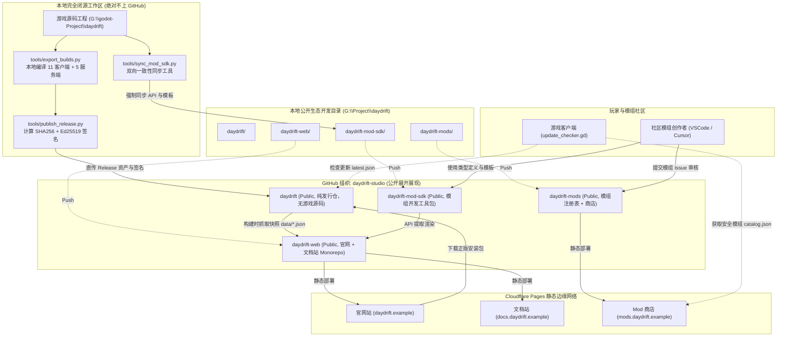

# 《度日：Daydrift》全景系统架构与生态规范

> 本文档由 Daydrift Studio 制定，用于阐述《度日：Daydrift》从本地私有游戏开发、安全构建导出、数字签名发布到公开站点静态托管的全景生命周期体系。

---

## 1. 系统全景架构图

---

## 2. 仓库职责与隔离边界

| 仓库名称 | 物理路径 | 开源属性 | 核心承载内容与职责 |
| :--- | :--- | :--- | :--- |
| **本地游戏内核** | `G:\godot-Project\daydrift` | **本地私有** | 纯本地闭源开发，包含游戏全部底层逻辑、美术、音效、场景与本地构建流水线。**绝不建立 GitHub 源码仓库**。 |
| **`daydrift`** | `G:\Project\daydrift\daydrift` | **Public** | **官方公开版本发行仓库**。不含源码，仅含 README、EULA、Issues 以及 GitHub Releases 中托管的 16 个全平台构建包与签名。 |
| **`daydrift-web`** | `G:\Project\daydrift\daydrift-web` | **Public** | **官网与文档站 Monorepo**。基于 Astro + Starlight，采用纯静态 SSG 模式，读取 Release 快照与 SDK 文档。 |
| **`daydrift-mods`** | `G:\Project\daydrift\daydrift-mods` | **Public** | **Mod 商店与安全注册表**。管理 Ed25519 签名、社区模组审核、确定性打包以及静态商店站点。 |
| **`daydrift-mod-sdk`** | `G:\Project\daydrift\daydrift-mod-sdk`| **Public** | **公开模组开发工具包**。提供 `mod_api.d.lua` 中文补全、Schema 规范、示例模板与开发指南。 |

---

## 3. 核心失败模式与安全兜底 (Failure Modes & Safeguards)

为确保整个供应链高度稳健，系统设定了严密的防御拦截机制：

1. **版本漂移拦截**：
   - 若 `version.json` 与 `src/autoload/update_checker.gd` 版本号不一致，本地发布脚本直接中断，禁止生成 Release 清单；
   - 运行 `python tools/sync_mod_sdk.py --check` 时，若发现游戏内核与 SDK 存在哈希差异，CI 与发布流程直接报错。
2. **签名失败与伪造拦截**：
   - 任何资产或 JSON 清单被篡改（即使仅修改一个字节或空格），Ed25519 校验立即失败；
   - 静态站点构建流水线必须执行全量校验，若检测到任一模组签名无效、密钥吊销或渠道错误，**整站构建直接失败并终止部署**，线上自动保留上一版本，坚决执行“零带病发布”。
3. **接口泄露拦截**：
   - 站点构建采用纯静态脱敏快照，严禁任何前端页面在运行时请求私有资源或直连外部 API；
   - 导出的发布包经过脱敏脚本检测，确保不包含调试符号、编辑器缓存或内部机器路径。
